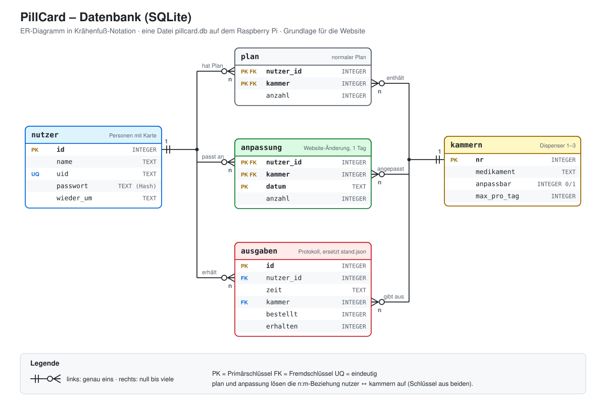

# Datenbank

Der Pi hält seine Daten in der SQLite-Datei `~/pillcard/pillcard.db`. Angelegt und befüllt wird
sie von [`pi/datenbank.py`](../pi/datenbank.py), `pi/pillcard.py` fragt dort die heutige Dosis ab
und trägt jede Ausgabe ein. Die Website ([Website.md](Website.md)) arbeitet auf derselben Datei.

Nutzer, Pläne und Kammern werden über die Website gepflegt. `pi/plaene.json` dient nur noch für
den allerersten Start (`venv/bin/python datenbank.py import`). `venv/bin/python datenbank.py zeigen`
zeigt den Inhalt der Tabellen.



| Tabelle | Inhalt |
|---|---|
| `nutzer` | Personen mit RFID-Karte oder Chip, Benutzername und Passwort (nur als Hash) für die Website |
| `kammern` | Was in Dispenser 1–3 liegt, ob Nutzer es selbst anpassen dürfen und bis zu welcher Menge, Vorrat, Grundstellung des Servos |
| `plan` | Der normale Plan: wer bekommt wie viel aus welcher Kammer |
| `anpassung` | Änderung über die Website, gilt nur für ein Datum |
| `einnahmen` | Eine Zeile pro Auftrag an den ESP32: ob der Becher stand und wann er hochgenommen wurde |
| `ausgaben` | Jede Ausgabe pro Kammer, mit der laut Mikrofon wirklich ausgegebenen Menge; gehört zu einer Einnahme |
| `einstellungen` | Schlüssel/Wert, zurzeit nur das Passwort der Verwaltung (Hash) |
| `scan_auftrag` | Website wartet auf eine Karte zum Anlernen; `pillcard.py` trägt die UID ein |
| `rezepte` | Welche Kammer wann per E-Rezept neu belegt wurde, mit dem gescannten QR-Text |
| `servo_befehl` | Warteschlange der Kalibrier-Seite (`servo 3 12`, `probe 3`); `pillcard.py` holt sie ab und schickt sie an den ESP32 |

`plan` und `anpassung` lösen die n:m-Beziehung zwischen `nutzer` und `kammern` auf.

## Schema

```sql
CREATE TABLE nutzer (
  id         INTEGER PRIMARY KEY,
  name       TEXT NOT NULL,
  uid        TEXT UNIQUE NOT NULL,      -- RFID, z. B. '3D AB 09 01'
  passwort   TEXT NOT NULL,             -- nur als Hash, '' = noch kein Login
  wieder_um  TEXT,                      -- z. B. '18:00'
  benutzername TEXT UNIQUE              -- Login auf der Website
);

CREATE TABLE kammern (
  nr          INTEGER PRIMARY KEY,      -- 1, 2, 3
  medikament  TEXT NOT NULL,            -- z. B. 'Magnesium'
  anpassbar   INTEGER DEFAULT 0,        -- 1 = Nutzer darf selbst ändern
  max_pro_tag INTEGER DEFAULT 1,        -- Grenze nur für die Selbstanpassung, z. B. 2
  vorrat      INTEGER DEFAULT 0,        -- jede Ausgabe zieht ab
  warnen_ab   INTEGER DEFAULT 10,       -- ab hier Hinweis "Vorrat geht zu Ende"
  ruhe_winkel INTEGER,                  -- Grundstellung des Servos, z. B. 170 (Website: Servos)
  richtung    INTEGER,                  -- -1 oder 1: Ausgabe bei ruhe_winkel - drehung bzw. + drehung
  drehung     INTEGER                   -- so weit dreht der Servo zur Ausgabe, 10–180°, Start 90
);

CREATE TABLE plan (
  nutzer_id  INTEGER REFERENCES nutzer(id),
  kammer     INTEGER REFERENCES kammern(nr),
  anzahl     INTEGER NOT NULL,
  PRIMARY KEY (nutzer_id, kammer)
);

CREATE TABLE anpassung (
  nutzer_id  INTEGER REFERENCES nutzer(id),
  kammer     INTEGER REFERENCES kammern(nr),
  datum      TEXT NOT NULL,             -- '2026-10-29'
  anzahl     INTEGER NOT NULL,
  PRIMARY KEY (nutzer_id, kammer, datum)
);

CREATE TABLE einnahmen (                -- ein Auftrag an den ESP32 = eine Einnahme
  id          INTEGER PRIMARY KEY,
  nutzer_id   INTEGER REFERENCES nutzer(id),
  zeit        TEXT NOT NULL,            -- gleiche Zeit wie die Zeilen in ausgaben
  auftrag_nr  INTEGER,                  -- Nummer im AUFTRAG, kommt in BECHER-Meldungen zurück
  becher      TEXT,                     -- 'stand', 'abgebrochen', 'fehlte'; NULL = ESP32 hat nicht geantwortet
  entnommen   TEXT                      -- wann der Becher hochgenommen wurde; NULL = (noch) nicht
);

CREATE TABLE ausgaben (
  id          INTEGER PRIMARY KEY,
  nutzer_id   INTEGER REFERENCES nutzer(id),
  zeit        TEXT NOT NULL,            -- '2026-10-29 08:01:12'
  kammer      INTEGER REFERENCES kammern(nr),
  bestellt    INTEGER,
  erhalten    INTEGER,                  -- laut Mikrofon
  einnahme_id INTEGER REFERENCES einnahmen(id)  -- NULL bei Ausgaben von vor der Becherbestätigung
);

CREATE TABLE einstellungen (
  schluessel TEXT PRIMARY KEY,          -- 'admin_passwort'
  wert       TEXT
);

CREATE TABLE scan_auftrag (
  id         INTEGER PRIMARY KEY,
  angefragt  TEXT NOT NULL,             -- gilt 2 Minuten
  uid        TEXT                       -- leer, bis eine Karte an den Leser kommt
);

CREATE TABLE rezepte (                  -- jede Neubelegung einer Kammer per E-Rezept
  id          INTEGER PRIMARY KEY,
  eingelesen  TEXT NOT NULL,            -- '2026-10-29 14:03:11'
  kammer      INTEGER REFERENCES kammern(nr),
  nutzer_id   INTEGER REFERENCES nutzer(id),
  medikament  TEXT NOT NULL,
  pro_tag     INTEGER NOT NULL,
  vorrat      INTEGER NOT NULL,         -- eingefüllte Tabletten
  rezept_id   TEXT,                     -- Id aus dem CHMED16A-Rezept
  roh         TEXT                      -- gescannter QR-Text
);

CREATE TABLE servo_befehl (             -- nur kurz gefüllt, beim Kalibrieren
  id         INTEGER PRIMARY KEY,
  befehl     TEXT NOT NULL,             -- 'servo 3 12' oder 'probe 3', sonst verwirft pillcard.py ihn
  angefragt  TEXT NOT NULL              -- älter als 10 s: verfällt
);
```

Eine Kammer gilt als **leer**, wenn `vorrat` 0 ist. `pillcard.py` prüft das alle 2 s und schickt dem
ESP32 `LEER 0 1 0`, der damit die LEDs an den Einfüllstutzen schaltet.

Die Servo-Winkel schickt `pillcard.py` genauso: nach jeder Änderung und alle 30 s
`WINKEL 170 80 170 80 10 100` (Ruhe und Ausgabe je Kammer, Ausgabe = Ruhe ± Drehung). Bis dahin nutzt
der ESP32 die Startwerte aus dem Sketch.

Spalten, die später dazugekommen sind (`benutzername`, `vorrat`, `warnen_ab`, `ruhe_winkel`, `richtung`, `drehung`,
`einnahme_id`), trägt `datenbank.verbinden()` in einer älteren Datei automatisch nach.

## Becherbestätigung

Der Becher steht auf zwei Kupferflächen (IO13, siehe [Verkabelung.md](Verkabelung.md)). Pro Einnahme
hält `einnahmen` fest, was mit dem Becher passiert ist:

| `becher` | `entnommen` | Bedeutung |
|---|---|---|
| `stand` | Zeit | Tabletten fielen in den Becher, danach wurde er hochgenommen und blieb 30 s weg |
| `stand` | NULL | Tabletten fielen in den Becher, er steht noch da oder kam innerhalb von 30 s zurück (oder der ESP32 wurde neu gestartet) |
| `abgebrochen` | Zeit | Becher wurde mitten in der Ausgabe weggenommen, `ausgaben.erhalten` zeigt, was bis dahin kam |
| `fehlte` | NULL | Kein Becher innerhalb von 15 s, nichts ausgegeben (`erhalten` leer) |
| NULL | NULL | ESP32 hat nicht geantwortet |

Ob die Tabletten herausgekommen sind, steht weiter pro Kammer in `ausgaben.erhalten` (Mikrofon).
Dazu meldet der ESP32 `BECHER 17 abgebrochen` (während der Ausgabe) und nach `FERTIG`
`BECHER 17 genommen 30`, sobald der Becher 30 s lang weg ist (`BECHER_ENTNAHME_MS` im Sketch). Die Zahl
sagt, vor wie vielen Sekunden er hochgenommen wurde. `pillcard.py` rechnet damit die Zeit zurück und
trägt sie bei der jüngsten Einnahme mit dieser Auftragsnummer ein. Kommt vor der Entnahme schon der
nächste Auftrag, bleibt `entnommen` leer.

Bis zur Entnahme zeigt das Display „Ihre Medikation / liegt bereit“, bei fehlenden Tabletten im
Wechsel mit „Fehlt: K1 / Pflege rufen“. Hat das Mikrofon gar nichts gehört, steht nur „Fehlt“ da.
Ist der Becher abgehoben, steht „Bitte einnehmen“ da; wird er vor Ablauf der 30 s zurückgestellt,
wieder „liegt bereit“.

> [!warning] Leerer Becher, der schnell zurückkommt
> Wer schluckt und den leeren Becher innerhalb von 30 s zurückstellt, gilt als „nicht entnommen“.
> Ein leerer und ein voller Becher sehen für das Kupferband gleich aus.

Einnahmen, deren Becher nicht abgeholt wurde:

```sql
SELECT n.name, e.zeit, SUM(a.erhalten) AS tabletten
FROM einnahmen e
JOIN nutzer n   ON n.id = e.nutzer_id
JOIN ausgaben a ON a.einnahme_id = e.id
WHERE e.becher = 'stand' AND e.entnommen IS NULL
GROUP BY e.id ORDER BY e.zeit DESC;
```

## Heutige Dosis für eine Karte

Die Menge im Plan legt die Verwaltung frei fest (0–9 pro Kammer, mehr nimmt der ESP32 nicht an).
Eine Anpassung des Nutzers für heute gewinnt nur bei anpassbaren Kammern und nur bis `max_pro_tag`
– liegt der Plan höher, bis zum Plan:

```sql
SELECT p.kammer,
       CASE WHEN k.anpassbar = 1 AND a.anzahl IS NOT NULL
            THEN MIN(a.anzahl, MAX(k.max_pro_tag, p.anzahl))
            ELSE p.anzahl END AS anzahl
FROM nutzer n
JOIN plan p     ON p.nutzer_id = n.id
JOIN kammern k  ON k.nr = p.kammer
LEFT JOIN anpassung a
       ON a.nutzer_id = n.id AND a.kammer = p.kammer AND a.datum = DATE('now', 'localtime')
WHERE n.uid = :uid;
```

Schon genommen heute, wenn es dazu eine Zeile gibt:

```sql
SELECT 1 FROM ausgaben a JOIN nutzer n ON n.id = a.nutzer_id
WHERE n.uid = :uid AND DATE(a.zeit) = DATE('now', 'localtime') LIMIT 1;
```

Die Website schreibt `anpassung` nur für Kammern mit `anpassbar = 1` und nur Werte von 0 bis
`max_pro_tag` (bzw. bis zum Plan, falls der höher ist). Wurde heute schon ausgegeben, gilt eine Änderung erst für morgen.
