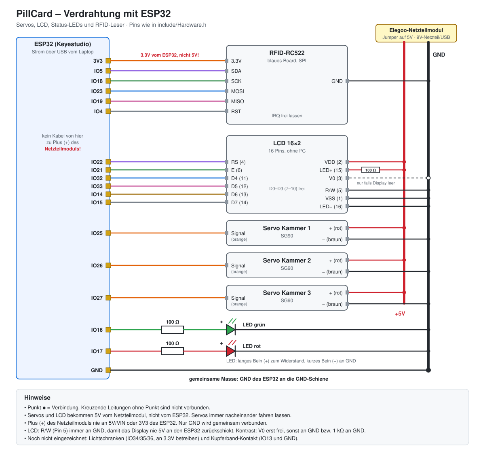
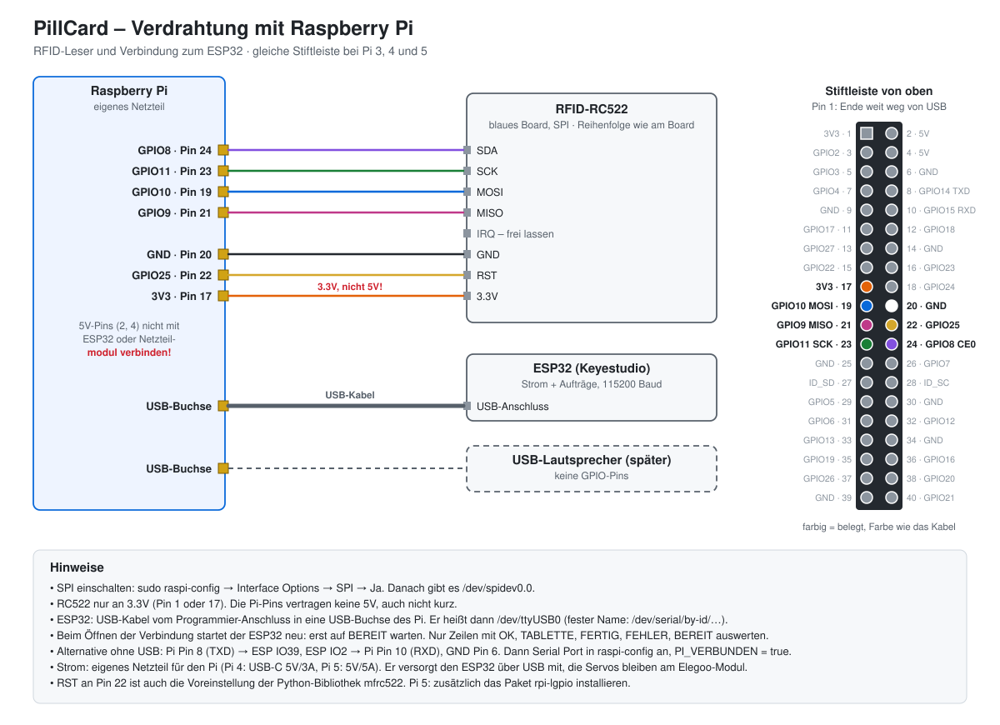

# Verkabelung

Pinbelegung wie im Sketch [`arduino-ide/PillCard_Demo`](../arduino-ide/PillCard_Demo/PillCard_Demo.ino).
Wer umsteckt, ändert es dort. Die älteren Test-Sketches nehmen [`include/Hardware.h`](../include/Hardware.h),
dort hängt der RC522 noch am ESP32.

## ESP32 (aktuell benutzt)

| Bauteil | Bauteil-Pin | ESP32 | Hinweis |
|---|---|---|---|
| ~~RFID-RC522~~ | – | – | hängt jetzt am Raspberry Pi (siehe unten). Früher IO5 / IO18 / IO23 / IO19 / IO4; zurück an den ESP32 nur mit `RFID_AUF_ESP = true`, dann ohne Leer-LEDs |
| **LCD 16×2** (16 Pins, ohne I²C) | 1 VSS | GND-Schiene | Pin 1: von vorne gesehen ganz links; auf der Rückseite rechts, eckiges Lötpad |
| | 2 VDD | 5V-Schiene | |
| | 3 V0 (Kontrast) | mittleres Bein des Potis (10 kΩ, B103) | Poti-Außenbeine an 5V-Schiene und GND-Schiene (vertauscht dreht nur die Richtung um), wie im Arduino-Beispiel `LiquidCrystal/HelloWorld`. Drehen, bis die Schrift klar ist; Datenblatt: V0 ≈ 1.2 V |
| | 4 RS | IO22 | |
| | 5 R/W | **GND-Schiene** | Pflicht: sonst schickt das Display 5V an den ESP32 |
| | 6 E | IO21 | |
| | 7–10 DB0–DB3 | – | frei lassen (4-Bit-Modus) |
| | 11 DB4 / 12 DB5 | IO32 / IO33 | |
| | 13 DB6 / 14 DB7 | IO14 / IO15 | |
| | 15 LED+ | 5V-Schiene über 100 Ω | Hintergrundbeleuchtung |
| | 16 LED− | GND-Schiene | |
| **Servo Kammer 1 / 2 / 3** | Signal (orange) | IO25 / IO26 / IO27 | |
| | + (rot) / − (braun) | 5V-Schiene / GND-Schiene | |
| **LED grün** | + (langes Bein) | IO16 über 100 Ω (braun-schwarz-braun) | − an GND |
| **LED rot** | + (langes Bein) | IO17 über 100 Ω (braun-schwarz-braun) | − an GND |
| **Leer-LED Kammer 1 / 2 / 3** | + (langes Bein) | IO18 / IO19 / IO23, je über 100 Ω | − an GND; sitzt oben am Einfüllstutzen, leuchtet bei Vorrat 0. Pins sind frei, weil der RC522 am Pi hängt |
| **Mikrofon (analoges Modul)** | S (Signal) | IO34 | liegt unter allen Kammern, ersetzt die Lichtschranken (Sketch `PillCard_Demo`) |
| | V | **3V3** | nicht 5V, sonst kann S bis zu 5V an IO34 legen |
| | G | GND-Schiene | |
| **Raspberry Pi** | USB-Buchse | USB-Anschluss des ESP32 | ein USB-Kabel für Strom und Aufträge, Alternative mit 3 Kabeln siehe unten |
| ~~Lichtschranke 1 / 2 / 3~~ | OUT | ~~IO34~~ / IO35 / IO36 (VP) | nicht mehr geplant, IO34 hat jetzt das Mikrofon |
| **Kupferband Becher** | Bodenfläche A | GND-Schiene | äußerer Ring. `PillCard_Demo` gibt nur aus, wenn der Becher steht (`BECHER_PRUEFEN`, Befehl `becher` zum Ausrichten); einzeln testen mit [`Becher_Test`](../arduino-ide/Becher_Test/Becher_Test.ino) |
| | Bodenfläche B | IO13 über 1 kΩ | innere Fläche; dazu 10 kΩ von IO13 an 3V3 und 100 nF von IO13 an GND. Nie an 5V |
| **ESP32** | GND | GND-Schiene | gemeinsame Masse, Pflicht |

Strom: Das ESP32 läuft über USB. Servos und LCD hängen an der 5V-Schiene des
Elegoo-Netzteilmoduls (Jumper auf 5V, versorgt per 9V-Netzteil oder USB). Plus des Moduls
**nie** an 5V/VIN oder 3V3 des ESP32, nur GND wird gemeinsam verbunden.

## Raspberry Pi (RFID, Pläne, Website)

Der Pi liest die Karten und schickt dem ESP32 nur Aufträge (`AUFTRAG 17 K1=1 K3=2`) und welche
Kammern leer sind (`LEER 0 1 0`). Servos, Mikrofon, Display und LEDs bleiben am ESP32. Seit der RC522
am Pi hängt, haben IO18, IO19 und IO23 die Leer-LEDs; IO5 und IO4 sind frei.

Pin-Nummern sind die Stiftnummern der 40-poligen Leiste (gleich bei Pi 3, 4 und 5). Pin 1
ist das Ende, das am weitesten von den USB-Buchsen entfernt ist, ungerade Pins liegen innen.

| Bauteil | Pin am Bauteil | Raspberry Pi | Hinweis |
|---|---|---|---|
| **RFID-RC522** | SDA | GPIO8 / CE0 (Pin 24) | Chip-Auswahl |
| | SCK | GPIO11 / SCLK (Pin 23) | |
| | MOSI | GPIO10 / MOSI (Pin 19) | |
| | MISO | GPIO9 / MISO (Pin 21) | |
| | IRQ | – | frei lassen |
| | GND | GND (Pin 20) | |
| | RST | GPIO25 (Pin 22) | Voreinstellung der Python-Bibliothek `mfrc522` |
| | 3.3V | **3V3 (Pin 17)** | nie an 5V, die Pi-Pins vertragen keine 5V |
| **ESP32** | USB-Anschluss (zum Programmieren) | USB-Buchse | Strom und Aufträge über ein Kabel, 115200 Baud |
| **Lautsprecher (später)** | USB | USB-Buchse | keine GPIO-Pins |

Strom: Der Pi bekommt sein eigenes Netzteil (Pi 4: USB-C 5V/3A, Pi 5: USB-C 5V/5A) und versorgt
den ESP32 über das USB-Kabel mit. Die Servos bleiben am Elegoo-Netzteilmodul. Die 5V-Pins des Pi
(Pin 2 und 4) nicht mit dem ESP32 oder dem Netzteilmodul verbinden. GND ist über das USB-Kabel
automatisch gemeinsam.

Einrichten auf dem Pi:

1. `sudo raspi-config` → Interface Options → **SPI** → Ja.
2. ESP32 einstecken und prüfen: `ls /dev/spidev0.0 /dev/ttyUSB0` muss beide Dateien zeigen.
   Der Name `ttyUSB0` kann sich ändern; fest bleibt der Pfad unter `ls /dev/serial/by-id/`.
3. Pi 5: zusätzlich `rpi-lgpio` installieren, weil `RPi.GPIO` (von `mfrc522` benutzt) dort nicht läuft.

Im Sketch `PillCard_Demo` danach `RFID_AUF_ESP = false` setzen. `PI_VERBUNDEN` bleibt `false`,
der Sketch liest Aufträge schon über USB.

Worauf das Pi-Programm achten muss:

- Beim Öffnen der USB-Verbindung startet der ESP32 neu. Erst auf die Zeile `BEREIT` warten,
  dann Aufträge schicken.
- Über USB kommen auch Hilfstexte für den Seriellen Monitor. Nur Zeilen auswerten, die mit
  `OK`, `TABLETTE`, `FERTIG`, `FEHLER`, `BECHER` oder `BEREIT` anfangen.
- `BECHER 17 genommen 30` kommt erst nach `FERTIG`, wenn der Becher 30 s lang weg ist, also
  auch lange nach dem Auftrag. Die Zahl sagt, vor wie vielen Sekunden er hochgenommen wurde. Das Pi-Programm liest deshalb zwischen den Karten weiter mit
  (Tabelle `einnahmen`, siehe [Datenbank.md](Datenbank.md#becherbestätigung)).
- Fehlt der Becher, wartet der ESP32 pro Auftrag höchstens 15 s („Becher bitte hinstellen“).
  Kommt er nicht, meldet er `FEHLER kein_becher`. Wird er mittendrin weggenommen, bricht er ab
  und meldet `BECHER 17 abgebrochen` und `FERTIG` mit dem, was bis dahin kam. Beides passt in die Wartezeit des Pi
  (20 s + 5 s pro Tablette).

### Alternative: drei Kabel statt USB

Nur nötig, wenn der USB-Anschluss am Laptop bleiben soll (z. B. zum Mitlesen beim Testen). Der
ESP32 braucht dann eigenen Strom über USB.

| ESP32 | Raspberry Pi | Hinweis |
|---|---|---|
| IO39 (RX) | GPIO14 / TXD (Pin 8) | über Kreuz: TX an RX |
| IO2 (TX) | GPIO15 / RXD (Pin 10) | |
| GND | GND (Pin 6) | Pflicht, sonst kommen nur falsche Zeichen an |

Beide Seiten arbeiten mit 3.3V, ihr braucht keinen Pegelwandler. Auf dem Pi zusätzlich
`sudo raspi-config` → Interface Options → **Serial Port** → Login-Shell: **Nein**, Hardware: **Ja**;
die Schnittstelle heißt dann `/dev/serial0`. Im Sketch `PI_VERBUNDEN = true` setzen.

## RFID-Leser: I²C-Variante (nur für 4-Pin-Module)

Nur für Leser mit genau 4 Pins (GND, VCC, SDA, SCL). In `platformio.ini` dafür die Zeile
`build_flags = -D PILLCARD_RFID_I2C` einkommentieren.

> [!warning] Das blaue 8-Pin-Board kann kein I²C
> Der Pin „SDA“ auf dem blauen RC522-Board ist bei SPI die Chip-Auswahl (SS), nicht die
> I²C-Datenleitung. Das Board braucht immer alle 7 Kabel (IRQ bleibt frei).

| Leser | Arduino Uno |
|---|---|
| GND | GND |
| VCC | **3.3V** (Beschriftung am Modul prüfen: nur 5V, wenn dort ausdrücklich 5V steht) |
| SDA | A4 (oder der Pin „SDA“ neben AREF) |
| SCL | A5 (oder der Pin „SCL“ neben AREF) |

Adresse ist normalerweise 0x28 (`RFID_I2C_ADRESSE` in `Hardware.h`). LCD und Uhrmodul hängen
an denselben zwei Leitungen, das geht, solange jedes Gerät eine andere Adresse hat.

## Arduino Uno (Ausweichvariante, `uno_*`-Umgebungen)

| Bauteil | Bauteil-Pin | Arduino Uno | Hinweis |
|---|---|---|---|
| **RFID-RC522** | SDA | D10 | |
| | SCK | D13 | |
| | MOSI | D11 | |
| | MISO | D12 | |
| | IRQ | – | frei lassen |
| | GND | GND | |
| | RST | D9 | |
| | 3.3V | **3.3V** | **nicht an 5V!** |
| **Servo Kammer 1** | Signal (orange/gelb) | D3 | |
| **Servo Kammer 2** | Signal | D5 | |
| **Servo Kammer 3** | Signal | D6 | |
| alle Servos | + (rot) | externe 5V | siehe „Strom“ |
| alle Servos | − (braun) | GND | gemeinsame Masse mit Arduino |
| **Lichtschranke Kammer 1** | OUT / DO | D2 | VCC an 5V, GND an GND |
| **Lichtschranke Kammer 2** | OUT / DO | D4 | |
| **Lichtschranke Kammer 3** | OUT / DO | D7 | |
| **Kupferband Schale** | Streifen A | D8 | interner Pull-up, kein Widerstand nötig |
| | Streifen B | GND | Becherboden mit Alufolie/Kupfer überbrückt A und B |
| **LED grün** | Anode (langes Bein) | A0 | über 220 Ω, Kathode an GND |
| **LED rot** | Anode | A1 | über 220 Ω, Kathode an GND |
| **LCD 16×2 mit I²C-Modul** | SDA | A4 | |
| | SCL | A5 | |
| | VCC / GND | 5V / GND | |
| *Uhrmodul (optional)* | SDA / SCL | A4 / A5 | teilt sich den Bus mit dem LCD |

Frei bleiben D0/D1 (USB-Seriell), A2 und A3 (z. B. Mikrofon für Plan B an A2).

## Strom

- Ein SG90 zieht beim Anlaufen bis ca. 650 mA, der USB-Port liefert 500 mA. Wenn mehrere
  Servos am 5V-Pin des Arduino hängen, bricht die Spannung ein und der RC522 oder der
  Arduino startet neu.
- Besser: Servos an eine eigene 5V-Quelle (Breadboard-Netzteilmodul aus dem Elegoo-Kit,
  5V-Netzteil oder 4×AA), **GND der Quelle mit GND des Arduino verbinden**.
- Für erste Tests reicht USB, solange immer nur ein Servo fährt (macht der Bauteiltest so).

### Variante: ESP32 als zweite 5V-Quelle

Das ESP32-Board (Keyestudio) dient hier nur als „zweiter USB-Anschluss“, es läuft kein Programm darauf.

| von | nach |
|---|---|
| ESP32 Pin **5V** bzw. **VIN** | Plus-Schiene Breadboard → rotes Kabel aller 3 Servos |
| ESP32 **GND** | Minus-Schiene Breadboard → braunes Kabel der Servos **und** GND des Arduino |
| Arduino D3 / D5 / D6 | Signal der Servos (wie oben) |

- ESP32 per USB versorgen (zweiter Laptop-Port, Powerbank oder USB-Netzteil).
- Vorher mit dem Multimeter messen: zwischen 5V/VIN und GND sollten ca. 4.7–5 V anliegen.
  **Nicht den 3.3V-Pin nehmen**, der Regler schafft keine Servos.
- **5V des ESP32 nie mit 5V des Arduino verbinden**, nur GND gemeinsam.
- Mehr als USB-Strom (ca. 500 mA) gibt es so auch nicht. Servos deshalb weiterhin nacheinander
  fahren lassen. Ein Elko (100–1000 µF) zwischen Plus- und Minus-Schiene fängt Stromspitzen ab.

## Reihenfolge beim Aufbauen

Jedes Teil einzeln anschliessen und sofort mit `env:bauteiltest` prüfen:

1. **RC522** → Taste `r`. Bei „Firmware Version: 0x92“ (oder 0x91/0x88/0xB2) ist alles gut.
   `0x00` oder `0xFF` heisst: Verkabelung prüfen, meist SDA/RST vertauscht oder 3.3V fehlt.
2. **LEDs** → `l`.
3. **LCD** → `d`. Leer oder nur Kästchen? Am Kontrast-Poti drehen.
4. **Servos** → `s`. Winkel in `Hardware.h` (`SERVO_RUHE`, `SERVO_AUSGABE`) an den Schieber anpassen.
5. **Lichtschranken und Kupferband** → `z`. Beobachten, ob „unterbrochen“ HIGH oder LOW ist,
   und `LICHTSCHRANKE_UNTERBROCHEN` in `Hardware.h` passend setzen.

## Annahmen, die ihr prüfen müsst

- **LCD hat kein I²C-Modul** (16 Pins). Mit ESP32 kein Problem, der Arduino Uno hätte dafür
  nicht genug freie Pins.
- **Lichtschranken sind Module mit Digitalausgang** (3 Pins: VCC, GND, OUT). Wenn ihr eine
  nackte IR-LED mit Fototransistor habt, braucht es Widerstände und ggf. Analogpins.
- **Karten sind MIFARE Classic 1K** (die weissen Karten und blauen Schlüsselanhänger aus dem
  Elegoo-Kit sind das). NTAG-Sticker gehen mit dem Codierer nicht.
